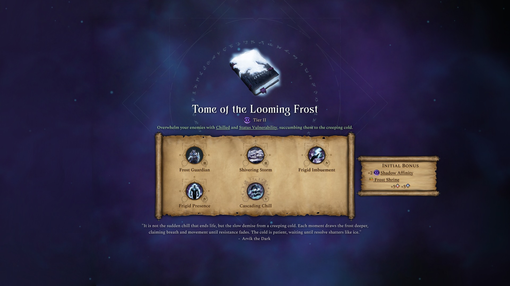
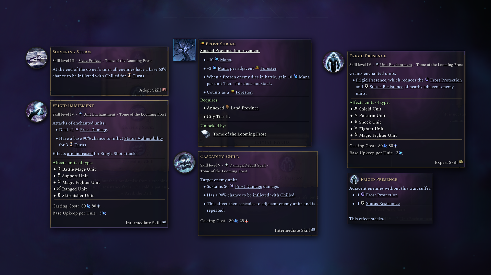
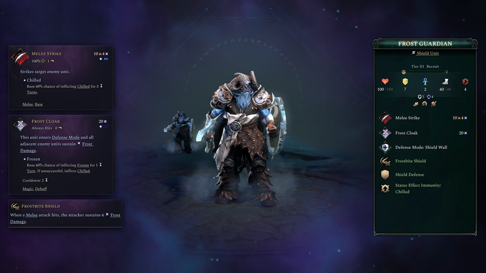

# AoW4 Tome Docs

Steam Workshop images and descriptions for **Age of Wonders 4 tome mods**,
captured straight from the game's encyclopedia:

- **`<Tome> - Overview.png`** – the tome page as shown in game, side panel blended away
- **`<Tome> - Tooltips.png`** – every skill tooltip with your icon art beside it
  (units are left out – they get their own)
- **`<Unit>.png`** – each tome unit's page (racial units in the form you pick)
  with its key ability tooltips alongside
- **`<Mod> - Description.txt`** – a short BBCode description for the Workshop
  page covering all the mod's tomes, written by the agent from the captured
  tooltips and your .po files

Python drives the game and does the capturing, cropping and compositing: it
opens the encyclopedia from the main menu, searches each tome, reads the page
to find the skills and hovers each one. An LLM agent turns your requests into
settings, runs the tool, reviews the resulting images and fixes what looks
off, and writes the Workshop description.

## Example output

From the *Tomes of Winter* mod:

| Tome overview | Skill tooltips | Unit page |
|---|---|---|
|  |  |  |

## How to use it

Open an AI coding agent (Claude Code, Copilot, Codex, ...) in this folder and
tell it what you want, e.g.:

> Make workshop images and a description for my mod in
> `C:\...\Age of Wonders 4\Mods\My Tome Mod`. My icons are in `C:\Mod Graphics\My Tome`.

The agent follows [AGENTS.md](AGENTS.md). You only need to:

1. Have **Python 3.10+** installed.
2. Start the game (**Display Mode: Borderless or Windowed**, English, mod
   enabled) and stay on the **main menu**.
3. When the agent asks, **let go of the mouse** for ~30 seconds per tome
   while it captures.

Prefer doing it by hand? See the commands in [AGENTS.md](AGENTS.md).

Finished files land in `output/<project>/` (working files in its `_captures`
folder). The description is a draft - give it a read.

## Nested tooltips

Want a nested tooltip for a hyperlink referenced inside the main tooltip? Just ask:
"also capture the *Arcfire* tooltip inside *Arcfire Strike*".

## Notes

- The encyclopedia UI is removed by blending the background back together,
  and the blend isn't always perfect. If a unit page looks off, take the
  captured page image from `output/<project>/_captures/`, reblend it yourself,
  and set the unit's `base_image` in `projects/<name>.json` to your version -
  the tool then uses it as is and only overlays the tooltips on top (rerun
  `compose`, no game needed).
